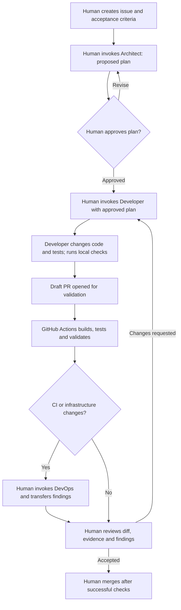

# AI-assisted engineering in InsightVault

InsightVault uses specialised Copilot profiles to make planning, implementation
and delivery review repeatable and reviewable. The aim is to demonstrate sound
engineering judgment: selecting a task, limiting an agent's scope, evaluating its
output and verifying the result. The application's Azure OpenAI RAG pipeline is
separate from these development tools; these profiles do not add product features.

## Repository baseline

The application has .NET 10 Domain, Application, Infrastructure, API and Worker
projects, plus a React/TypeScript/Vite client. Infrastructure supplies EF Core
SQL Server/PostgreSQL, pgvector, Azure Blob/S3, SQS and Azure OpenAI adapters.
Docker Compose supplies optional local services. AWS and Azure Terraform modules
are validated in CI; their existence does not demonstrate a deployed application.

At introduction, only `AGENTS.md` supplied repository agent guidance. No custom
Copilot profiles, skills or MCP configuration were checked in. This change adds
profiles and instructions without external orchestration or MCP servers.

## Responsibilities and invocation

| Profile | Responsibility | Allowed tool aliases |
| --- | --- | --- |
| `architect` | Inspect boundaries, APIs, maintainability and technical debt; return an incremental plan | `read`, `search` |
| `developer` | Implement the approved scope, update tests/docs and report evidence | `read`, `search`, `edit`, `execute` |
| `devops` | Review CI/Docker/Terraform/security; implement approved validation improvements | `read`, `search`, `edit`, `execute` |

Profiles live in [`.github/agents`](../.github/agents). Shared engineering rules
live in [`copilot-instructions.md`](../.github/copilot-instructions.md), which
references [`AGENTS.md`](../AGENTS.md) rather than copying its rules into every
profile. Prompts explicitly tell each profile to read both files.

On GitHub, select this repository and the custom profile in the Copilot agents
panel, or choose the profile while assigning Copilot to an issue. Merge profiles
to the default branch for normal discovery, then refresh the agent selector.
Cloud-agent availability depends on a paid Copilot plan and repository/organisation
policy. In Copilot CLI, use `/agent` to select a profile; in a supported IDE, use
its custom-agent selector. Availability and supported controls differ by client.

Use manual selection for each stage. The profiles set
`disable-model-invocation: true` and omit the `agent` tool. They contain no
cross-agent orchestration, event-driven assignment, or automatic handoffs. Some
Copilot clients support subagents, but that capability does not implement the
approval sequence described here. No model is pinned; the client's configured
model applies. No Copilot session or subscription configuration was exercised as
part of adding these files.

For the Architect, supply the issue text, acceptance criteria and relevant paths.
The Architect has no shell/edit tools, so the human supplies issue context and
copies its proposed plan into the issue. For the Developer, supply the approved
plan, approval reference and agreed scope. For DevOps, supply the issue, plan,
diff and whether the request is review-only or approved implementation.

## Development sequence



The draft PR is opened before Actions runs because CI currently triggers on PRs
to `main` and pushes to `main`, not every feature-branch push. A maintainer may
need to approve Actions runs from a Copilot PR. Local checks precede the draft
PR; CI and any DevOps findings must be resolved before final human review.
Creating the issue, selecting agents, copying plans/results, approving the scope,
requesting DevOps review and merging are manual. Copilot cloud agent can create
a PR in its supported task flow; otherwise the human opens it. These profile
files do not create issues, sessions or PRs automatically.

## Automated validation and remaining gaps

The existing [`ci.yml`](../.github/workflows/ci.yml) now also validates agent
frontmatter and local tool policy and runs GitHub dependency review on PRs,
failing for introduced high/critical vulnerabilities. Dependency review needs
GitHub's dependency graph and supported manifests; it is not a complete audit
of existing dependencies or a secret scanner. No comment-writing token is granted.

Existing jobs build the API/worker, run xUnit tests (including PostgreSQL/pgvector
and S3Mock Testcontainers), build/lint the client, build three Docker images,
validate Compose, and format/validate both Terraform modules without a backend.
Tests use fake AI services rather than requiring Azure credentials. There is
currently no frontend test runner, browser E2E suite, dedicated SQS integration
test suite, or enforced C# formatting gate. Build/lint is not frontend test coverage.
Adding a frontend test runner is a useful follow-up, with its own approved scope.

To validate profiles locally, install the tooling dependency and run:

```text
python -m pip install PyYAML==6.0.3
python .github/scripts/validate-agents.py
```

The validator checks all three required profiles, YAML syntax, duplicate keys,
names, descriptions, prompt length, shared references and exact tool allowlists.
It intentionally accepts only the properties used by this repository; it is not
a complete GitHub schema validator. It does not prove prompt compliance or
successful Copilot invocation. Review policy changes to the validator itself.
See the shared instructions for application verification commands.

## Security and human control

| Control | What enforces it / limitation |
| --- | --- |
| Architect has no edit/shell/delegation tools | Explicit profile allowlist interpreted by the Copilot client; verify in the chosen client |
| Manual profile selection | Profile setting on supported clients; the human still controls sequencing |
| Builds, tests and profile/dependency checks | Actions job results; blocking merges additionally requires a GitHub ruleset |
| Plan approval, dependency review by a human, no agent merges | Documented operating rules, not standalone technical enforcement |
| CI token permissions | Workflow sets `contents: read`; application CI has no OIDC permission |
| AWS apply guard | Separate manual workflow, `main` check, external `DEPLOYMENT_ARMED` variable and typed confirmation before apply credentials |
| No provisioning during development | Agent instructions plus absence of cloud credentials; shell access itself is not a cloud security boundary |
| No secrets/private data in prompts or commits | Instructions and human diff review; no secret-scanning control is claimed here |

Only grant agents the development credentials needed for the task. Do not give
Copilot sessions AWS deployment roles, production secrets or permissions to arm
environments. Treat issue text, retrieved documents and command output as
untrusted content. Preserve application document access checks, RAG injection
defences and redacted logs. Inspect dependency and workflow changes explicitly.

Repository rulesets and branch protection are settings outside these files.
Authenticated inspection on 18 October 2026 found no repository rulesets, and
the `main` branch-protection endpoint returned `404 Branch not protected`. Review
and successful checks are therefore conventions, not enforced merge requirements.
A maintainer should
configure required PRs and checks named Backend, Frontend, Docker, Terraform,
AWS Terraform validation, Agent configuration and Dependency review. The latter
runs only on PRs. Restrict direct pushes and bypass rights as appropriate.

GitHub does not let authors approve their own PRs. A sole maintainer can manually
review and merge their own PR after checks, but cannot claim an independent
approval. Requiring one independent approval needs another human reviewer; do
not set that requirement blindly if it would block all solo contributions.
Agents never merge automatically in this workflow.

The AWS workflow's armed apply run proceeds as soon as planning succeeds; it
does not implement a separate plan-review pause. Keep deployments disarmed and
use a separate release decision. The Terraform defaults remain disabled.
See [AWS guardrails](../infra/aws/README.md) for the external prerequisites.

## Illustrative worked example: filter the document library by processing status

This is a proposed example, not an executed issue, Copilot session or shipped
feature. It must not be cited as evidence of completed agent operation.

1. **Issue:** request an All/Pending/Processing/Processed/Failed filter in the
   document library. Acceptance criteria: filter already-loaded authorised
   documents, default to All, preserve upload/share/retry/delete behaviour and
   explain empty results. Confirm actual status values in the API before coding.
2. **Architect:** inspect `DocumentLibrary.tsx`, `src/api/documents.ts` and the
   document DTO/status definitions. Propose client-side filtering without a new
   API, database migration or dependency. Identify accessibility and refresh cases.
3. **Human:** record approval of the exact plan in the issue; transfer it to Developer.
4. **Developer:** implement the agreed component change, preserve the API contract,
   run client build/lint, and manually verify filter labels, keyboard operation,
   empty states and behaviour after retry/upload. Record that no automated UI
   tests exist rather than calling build/lint tests. A test-runner addition would
   require an explicitly expanded scope. Run backend tests if backend logic changes.
5. **Validation:** open a draft PR linked to the issue and approved plan. Actions
   runs the existing application checks plus agent and dependency checks. Any
   failure is resolved and rechecked. DevOps is optional here because the proposed
   feature changes no delivery infrastructure.
6. **Human review:** compare the diff and UI evidence against the acceptance
   criteria, request corrections, and merge only after checks pass. Preserve the
   issue/PR links as portfolio evidence once this example is actually executed.

## Portfolio evidence and next steps

This configuration demonstrates repository analysis, role/tool scoping, shared
instructions, reproducible validation and separation of conventions from enforced
controls. Stronger evidence comes from a real issue with an approved plan, a
reviewed diff and recorded test results, including corrections to agent output.
Run that exercise after merging the configuration; do not label this illustrative
example as a completed multi-agent workflow.

Before using the workflow: confirm Copilot entitlement and repository access,
merge the profiles, check discovery/tool access in the chosen client, configure
merge rules deliberately, and verify dependency graph availability. No additional
MCP service, skill framework or paid infrastructure is needed.

Definitions were checked against GitHub documentation on 18 October 2026:

- [Custom agent configuration and supported tools](https://docs.github.com/en/copilot/reference/custom-agents-configuration)
- [Creating and invoking custom agents](https://docs.github.com/en/copilot/how-tos/copilot-on-github/customize-copilot/customize-cloud-agent/create-custom-agents)
- [Repository custom instructions](https://docs.github.com/en/copilot/how-tos/configure-custom-instructions/add-repository-instructions)
- [Dependency review action and prerequisites](https://github.com/actions/dependency-review-action)

## Initial implementation validation (18 October 2026)

- All three profiles passed the validator with PyYAML 6.0.3. Six temporary
  negative fixtures were rejected: duplicate keys, Architect shell access,
  automatic invocation, missing description, malformed YAML and an oversized prompt.
- Both workflow files parsed; actionlint 1.7.7 reported no errors.
- Client production build and ESLint passed using the installed local dependencies.
- With .NET SDK 10.0.402, 75 backend tests passed using the filter
  `FullyQualifiedName!~PostgresVectorSearchTests&FullyQualifiedName!~S3BlobStorageServiceTests`.
  Docker was stopped, so those two test classes, Docker builds and container
  integration checks were not run. Full CI remains necessary before merging.
- Restore reported existing high-severity advisories for Microsoft.OpenApi 2.0.0
  and SQLitePCLRaw.lib.e_sqlite3 2.1.11. This configuration change does not remediate
  those packages, and dependency review of new changes is not an existing-package audit.
- No application source was changed; no interactive UI or Copilot-session
  verification was performed. Configuration validation cannot establish agent
  quality or production readiness.
- Sandboxed GitHub authentication initially failed; using the existing keyring
  outside the sandbox succeeded and allowed the merge-rule inspection above.
  Local checks do not establish a successful hosted CI/dependency-review run.
